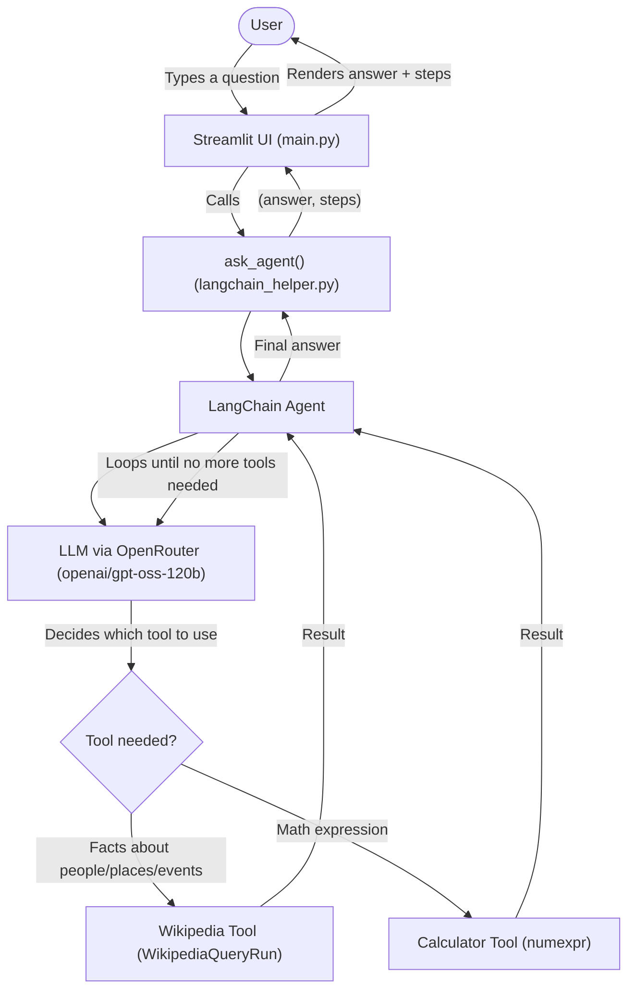
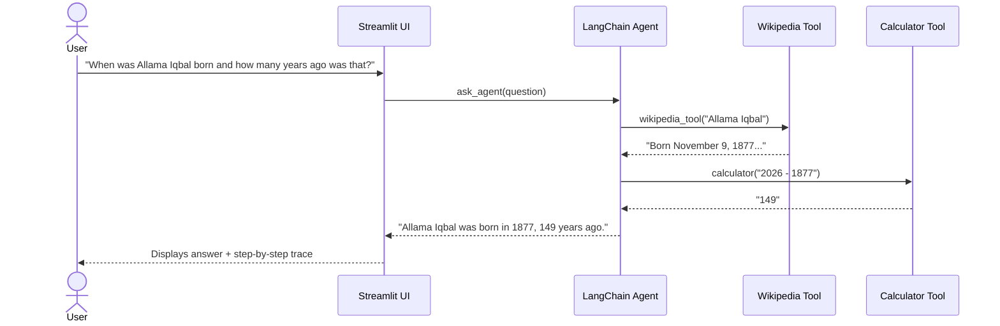

# Wikipedia + Calculator Agent


A Streamlit app where a LangChain agent answers questions by combining a Wikipedia lookup tool and a calculator tool. The agent's LLM (`openai/gpt-oss-120b`) is served through [OpenRouter](https://openrouter.ai) rather than directly through OpenAI.

## Features

- **Wikipedia lookups** — the agent can query Wikipedia for facts about people, places, and events via `WikipediaQueryRun`.
- **Calculator tool** — evaluates math expressions safely using `numexpr`, so the agent can do arithmetic (like "years ago" calculations) without hallucinating numbers.
- **Verbose mode** — an optional checkbox that shows every step the agent takes: the question, each tool call, the tool's result, and the final answer.
- **Simple Streamlit UI** — a single text input, an "Ask" button, and an expandable "Agent steps" panel.

## Architecture



## Example Flow

Sequence diagram for the question *"When was Allama Iqbal born and how many years ago was that?"*:



## Tech Stack

- **Python** — core language
- **Streamlit** — web UI
- **LangChain** — agent orchestration (`create_agent`, tool calling)
- **OpenRouter** — LLM provider/gateway (OpenAI-compatible API)
- **Wikipedia API** — via the `wikipedia` Python package and `langchain_community`'s `WikipediaQueryRun` tool
- **numexpr** — fast, safe numerical expression evaluation for the calculator tool

## Project Structure

| File | Description |
|------|--------------|
| `main.py` | Streamlit UI — text input, "Ask" button, and the verbose step viewer |
| `langchain_helper.py` | Builds the LLM, the Wikipedia and calculator tools, the agent, and `ask_agent()` |
| `requirements.txt` | Python dependencies for the project |
| `.env.example` | Template showing which environment variables are required |
| `.gitignore` | Excludes `.env`, `secret_key.py`, and other local/generated files from version control |

## Getting Started

1. **Clone the repo**
   ```bash
   git clone <repository-url>
   cd langchain-wikipedia-agent
   ```

2. **Create a virtual environment**
   ```bash
   python3 -m venv .venv
   source .venv/bin/activate  # On Windows: .venv\Scripts\activate
   ```

3. **Install dependencies**
   ```bash
   pip install -r requirements.txt
   ```

4. **Set up environment variables**
   ```bash
   cp .env.example .env
   ```
   Then open `.env` and paste in your own OpenRouter API key.

5. **Run the app**
   ```bash
   streamlit run main.py
   ```

## Environment Variables

| Variable | Required | Description |
|----------|----------|-------------|
| `OPENROUTER_API_KEY` | Yes | Your API key for [OpenRouter](https://openrouter.ai), used to call the `openai/gpt-oss-120b` model. Create a free key at [openrouter.ai](https://openrouter.ai). |

`.env` holds your real key and is listed in `.gitignore`, so it is never committed to GitHub — only `.env.example` (with an empty placeholder) is checked in.

> **Note:** OpenRouter requires account credits for most models to respond. If the agent fails to answer, check that your OpenRouter account has sufficient credits.

## Example Questions

- When was Allama Iqbal born and how many years ago was that?
- How old would Albert Einstein be if he were alive today?
- What year did the Wright brothers first fly, and how many years ago was that?
- Multiply the year the Eiffel Tower was completed by 2.

## A Note on API Keys

Your OpenRouter API key lives in `.env`, which is listed in `.gitignore` and **must never be committed** to version control. Only `.env.example` (with an empty placeholder) should be checked in.
